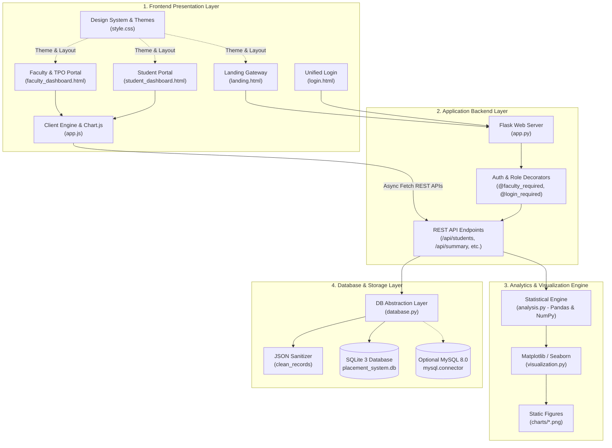

# EduPlace University Portal
## Technical Architecture Specification & Viva Preparation Guide

**Project Title:** EduPlace - Integrated Campus Placement & Analytics System  
**Academic Year:** 2024–2025 (Active Cohort: 2025)  
**Architecture Pattern:** Client-Server Model with RESTful API Micro-Services & Role-Based Access Control (RBAC)  

---

## 1. System Architecture Overview

The application is structured into four decoupled layers: **Frontend Presentation**, **Application Backend**, **Statistical Analytics & Visualization**, and **Relational Database Storage**.

---

## 2. Comprehensive File Inventory & Categorization

### Pillar A: Frontend Layer (Presentation & Client Logic)
* **Core Technologies:** HTML5, CSS3, Vanilla JavaScript (ES6+), FontAwesome Icons, Google Fonts.

| File Path | Technology | Functional Responsibility |
| :--- | :--- | :--- |
| `templates/landing.html` | HTML5 / Jinja2 | **Public Presentation Gateway:** Hero section with platform value proposition, live key metrics ticker, 13 core modules showcase, animated workflow timeline, interactive FAQ accordion, and primary *"Login to Dashboard"* CTA. |
| `templates/login.html` | HTML5 / Jinja2 | **Unified Authentication Gateway:** Single login portal with smart role auto-detection. Verifies credentials against faculty or student records and routes accordingly. |
| `templates/faculty_dashboard.html` | HTML5 / Jinja2 | **Faculty & TPO Workspace:** Administrative control center with 13 functional modules: Overview KPIs, All College Students directory, Corporate Partners, Placement Drives, Applications, Cutoff Rules, Offer Ledger, Analytics, and Audit Logs. |
| `templates/student_dashboard.html` | HTML5 / Jinja2 | **Student Career Portal:** Personalized student cockpit presenting individual CGPA, verified corporate offers, cutoff eligibility status, and high-demand technical skill benchmarks. |
| `templates/index.html` | HTML5 / Jinja2 | **Legacy Standalone Dashboard:** Single-page dashboard template maintained for backward compatibility. |
| `static/css/style.css` | CSS3 (Variables) | **Master Design System:** CSS custom properties defining palette tokens, zero-leakage Dark/Light theme rules, responsive Flexbox/Grid layouts, tables, and modal dialogs. |
| `static/js/app.js` | Vanilla JS (ES6+) | **Interactive Frontend Engine:** DOM management, dynamic tab navigation, REST API data orchestration, live search/filtering, modal interactions, and Chart.js visualizations. |

---

### Pillar B: Backend Layer (Application Server & REST APIs)
* **Core Technologies:** Python 3.14, Flask, Werkzeug Security, Pandas, NumPy.

| File Path | Technology | Functional Responsibility |
| :--- | :--- | :--- |
| `app.py` | Flask Framework | **Main Application Controller:** Initializes Flask, configures session security (`HTTPOnly`, `SameSite=Lax`), enforces Role-Based Access Control (`@login_required`, `@faculty_required`, `@student_required`), and serves 15+ REST endpoints. |
| `analysis.py` | Pandas & NumPy | **Statistical Analytics Engine:** Computes placement rates, department comparative metrics, salary distribution curves (Mean, Median, Std Dev, IQR, 25th/75th percentiles), and corporate skill demand. |
| `config.py` | Python | **Global Configuration:** Configures target graduation year (2025), salary unit conventions, directory paths (`charts/`, `reports/`), and dual-mode database engine switches (`sqlite` vs `mysql`). |
| `academic_data.py` | Python | **Academic Data Dictionary:** Department definitions, curriculum subject lists, and academic year constants. |
| `main.py` | Python CLI | **Console Interface:** Terminal-based menu for executing analytics and generating summary reports without launching a web browser. |

---

### Pillar C: Database Layer (Persistence & Data Integrity)
* **Core Technologies:** SQLite 3, MySQL Connector, SQL (DDL / DML).

| File Path | Technology | Functional Responsibility |
| :--- | :--- | :--- |
| `placement_system.db` | SQLite 3 File | **Active Relational Database:** Physical file hosting normalized tables (`students`, `faculty`, `placements`, `skills`, `student_skills`, `companies`, `placement_drives`, `applications`, `placement_audit_logs`). |
| `database.py` | Python DB-API | **Database Abstraction Layer:** Provides connection pooling, automated schema initialization (`init_database`), parameterized query execution (`fetch_dataframe`, `execute_non_query`), audit logging, and the `clean_records` JSON sanitizer. |
| `schema.sql` | SQL DDL | **Relational Schema Blueprint:** Clean SQL schema definitions with unique constraints, auto-incrementing primary keys, and foreign key cascades. |
| `seed_data.py` | Python / Random | **Data Generation Utility:** Seeds the database with realistic fictional student records across 5 engineering disciplines with verified corporate placement offers. |

---

### Pillar D: Visualization Layer (Analytics & Charting)
* **Core Technologies:** Chart.js (Browser), Matplotlib & Seaborn (Server-Side).

| Visualization Mechanism | Implementation File | Characteristics & Visuals Rendered |
| :--- | :--- | :--- |
| **Interactive Client Charts** | `static/js/app.js` (Chart.js) | Dynamic, animated canvas visualizations:  • **Cohort Status Donut:** Placed Eligible vs. Unplaced Eligible vs. Ineligible. • **Department Placement Rate Bar Chart:** Department comparisons. • **Package Distribution Curve:** Normal distribution of salary offers. |
| **Static Exportable Figures** | `visualization.py` (Matplotlib) | Publication-grade static figures saved to `charts/`:  • `dept_placement_rate.png` • `package_distribution.png` • `top_skills.png` • `cohort_status.png` |

---

## 3. Core REST API Specifications

All endpoints return strictly RFC 8259-compliant JSON data sanitized via `clean_records`:

| HTTP Method | Endpoint | RBAC Protection | Description / Payload |
| :--- | :--- | :--- | :--- |
| `GET` | `/api/summary` | `@login_required` | Returns high-level placement KPIs, overall placement rate %, and cohort counts. |
| `GET` | `/api/students` | `@login_required` | Returns full roster of students with CGPA, eligibility, offers, and skills. |
| `GET` | `/api/student/<id>` | `@login_required` | Returns full profile dossier for a single student including diploma details and offers. |
| `POST` | `/api/add-student` | `@faculty_required` | Registers a new regular or lateral-entry student with initial eligibility. |
| `PUT` | `/api/student/<id>` | `@faculty_required` | Updates student demographic, academic, or eligibility records. |
| `DELETE` | `/api/student/<id>` | `@faculty_required` | Archives and deletes a student record with audit log tracking. |
| `POST` | `/api/record-placement` | `@faculty_required` | Records a new corporate placement offer and updates student placement status. |
| `GET` | `/api/departments` | `@login_required` | Returns department-wise enrolled, placed, offer count, and avg/max packages. |
| `GET` | `/api/packages` | `@login_required` | Returns salary tier breakdown and descriptive statistics (Mean, Median, IQR). |
| `GET` | `/api/skills` | `@login_required` | Returns top technical skills ranked by market recruiter demand. |
| `GET, POST` | `/api/companies` | `@login_required` | Lists recruiting companies or registers a new corporate hiring partner. |
| `GET, POST` | `/api/placement-drives`| `@login_required` | Lists or schedules campus placement drives with department/CGPA cutoffs. |
| `GET, POST` | `/api/eligibility-rules`| `@faculty_required`| Retrieves or recalculates campus eligibility rules (min CGPA & max backlogs). |
| `GET` | `/api/audit-logs` | `@faculty_required` | Retrieves audit logs recording all data mutations and administrator actions. |

---

## 4. Key Engineering Highlights & Problem-Solving

### A. Resolution of the RFC 8259 JSON `NaN` Glitch
* **Problem:** In SQLite, fields like `diploma_college` for regular students are `NULL`. When loaded into Pandas, they became `np.nan`. Python's default serializer converted this to unquoted literal `NaN`. Modern browsers strictly follow RFC 8259, where `NaN` is illegal syntax, causing `res.json()` to crash with `SyntaxError: Unexpected token 'N'`.
* **Solution:** Engineered the recursive `clean_records` function that systematically maps `NaN`, `inf`, and `-inf` to Python `None` (which cleanly serializes to valid JSON `null`).

### B. Elimination of the SQL Cartesian Product
* **Problem:** Simultaneously left-joining `student_skills` (one-to-many) and `placements` (one-to-many) generated a Cartesian product that falsely multiplied placement counts by the number of skills.
* **Solution:** Replaced multi-table joins with indexed, correlated subqueries in SQL, guaranteeing exact offer counts and deduplicated skill tags.

### C. Zero-Leakage Dark / Light Theme Engine
* **Implementation:** CSS custom variables combined with a synchronous `<head>` script that reads `localStorage.getItem('eduplace_theme')` before render, preventing flash-of-unstyled-content (FOUC).

---

## 5. Examiner / Viva Q&A Guide

### Q1: "How did you prepare this website?"
> *"I followed a standard 5-stage Software Development Life Cycle: (1) Requirements gathering to separate Faculty and Student workflows; (2) Relational database schema design in SQLite/MySQL; (3) Backend API development using Python Flask; (4) Frontend engineering with responsive CSS and Chart.js; and (5) Data sanitization and Git version control."*

### Q2: "Why did you choose Flask over Django or Node.js?"
> *"Flask is a lightweight micro-framework that gives full architectural freedom without bloated defaults. More importantly, it integrates natively with Python's scientific computing libraries—Pandas and NumPy—allowing us to compute descriptive statistics and salary percentiles in sub-millisecond execution times."*

### Q3: "How is security and authentication handled?"
> *"We implemented secure, role-aware authentication using Werkzeug's `generate_password_hash` with salted hashes. Passwords are never stored in plaintext. Session cookies are protected with `HTTPOnly` and `SameSite=Lax` flags, and routes are guarded with custom Python decorators like `@faculty_required` and `@student_required`."*

### Q4: "How does the placement rate calculation work?"
> *"The placement rate follows the official university formula:  
> `Placement Rate (%) = (Unique Placed Eligible Students / Total Eligible Cohort Denominator) * 100`  
> Ineligible students (those with active backlogs or below CGPA cutoff) and duplicate multiple offers received by a single candidate are properly segmented so that the placement percentage never exceeds 100%."*

### Q5: "What database does this use, and can it scale?"
> *"It uses SQLite 3 for zero-setup local deployment, but the abstraction layer in `database.py` is dual-engine. By setting `DB_ENGINE = 'mysql'` in `config.py`, the entire system connects seamlessly to an enterprise MySQL 8.0 server without altering any application business logic."*

